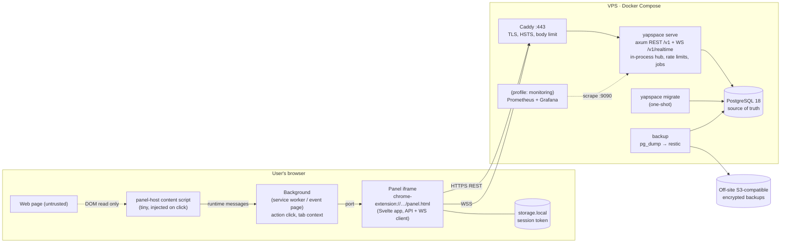

# YapSpace architecture overview

> Source of truth for this topic. Section letters (§X) refer to the original plan; the map is in [docs/plan/README.md](../plan/README.md#section-map). Change decisions only via an ADR / `docs/plan/decisions.md`.

## A. Executive summary & recommended stack

**The short version:** a single Rust binary (a modular monolith) built on Axum, backed by one PostgreSQL 18 database.
It serves REST under `/v1` and pushes real-time updates over WebSocket with in-process fan-out, behind Caddy, all in
Docker Compose on one VPS. The client is a WXT + Svelte 5 extension whose panel runs in an isolated extension iframe and is
only injected when the user clicks the toolbar button. There is no Redis, no broker, no search engine, and no
Kubernetes in the MVP. Each of those has a measured trigger in §L that says when to add it.

| Concern | Choice (version line at time of writing) | Main alternatives rejected (why) |
|---|---|---|
| Language | Rust (toolchain pinned 1.98) | — (required) |
| HTTP/WS framework | **axum 0.8** + tokio + tower/tower-http | actix-web: equally fast, but its own actor/runtime model and a smaller tower middleware ecosystem. poem/salvo/rocket: smaller communities |
| DB access | **sqlx 0.9** (`query!`/`query_as!` macros, offline `.sqlx` cache, embedded migrations) | Diesel: sync core (diesel-async is a separate crate) and a heavy DSL. SeaORM: ORM layer we don't need, and weaker compile-time SQL checking |
| Database | **PostgreSQL 18** (`postgres:18-alpine`) | CockroachDB/Yugabyte (distributed SQL: operational and cost overhead we don't need), MongoDB (relational integrity matters here), Cassandra/Scylla (wrong fit until write volumes are huge) |
| API style | REST/JSON `/v1` + **OpenAPI 3.1** generated by **utoipa 6** (+ utoipa-axum 0.3) | GraphQL (caching, complexity and abuse surface, no client need), gRPC (browsers need proxies) |
| Real-time | **WebSocket** (axum `ws`), in-process `tokio::sync::broadcast` per discussion | SSE (one-way only, and a client→server control channel would need extra requests; HTTP/1.1 connection limits), polling (latency and cost) |
| Multi-instance events (later) | **Postgres LISTEN/NOTIFY**, behind an `EventBus` trait. Then NATS if NOTIFY saturates | Redis Pub/Sub (one more datastore just for this), Kafka (overkill) |
| Cache | **None in the MVP** (Postgres + indexes). In-process `moka` later for hot reads | Redis: not justified at one instance |
| Auth | Self-managed username/password, **argon2id**, opaque bearer session tokens (SHA-256 stored) | JWT (revocation is hard), external IdP (cost, vendor lock-in, extension redirect quirks) |
| Rate limiting | In-process `governor` keyed limiters | Redis counters (needs Redis; only matters once there are several instances) |
| Reverse proxy/TLS | **Caddy 2** (automatic HTTPS, WebSocket support with no config) | Nginx (manual certs), Traefik (label-driven config is more moving parts) |
| Packaging | Docker multi-stage (cargo-chef) → `gcr.io/distroless/cc-debian13:nonroot` | Alpine/musl (slower allocator, build quirks), scratch (no CA/glibc) |
| Orchestration | Docker Compose v2 on one VPS | Kubernetes/Nomad (premature) |
| Observability | `tracing` JSON logs + Prometheus `/metrics` (internal port) + optional Prometheus/Grafana compose profile | Full OTel collector + Loki + Tempo (too heavy for one box at the start) |
| Extension | **WXT 0.21 + Svelte 5 + TS**, MV3 for Chrome and Firefox, `activeTab` + `scripting`, panel in an extension iframe | Plasmo (React-centric, less active), raw Vite (re-implementing the cross-browser manifest) |
| Desktop (later) | **Tauri 2** (Rust reuse, small binaries) | Electron (heavy), Flutter (no Rust reuse) |
| Search (later) | Postgres full-text search | OpenSearch/Meilisearch (another stateful service) |

**Irreversible or expensive decisions** (get these right now): discussion identity keys (§E), message ordering by
per-discussion `seq` (§D), UUIDv7 IDs, the REST error/pagination contract (§F), and putting the extension panel in an iframe (§I).
Everything else can be swapped later at reasonable cost.

**Sources** (primary docs; check them again when implementing):
axum docs <https://docs.rs/axum> · sqlx changelog/docs <https://github.com/launchbadge/sqlx> · PostgreSQL 18 docs (uuidv7, NOTIFY 8000-byte payload limit)
<https://www.postgresql.org/docs/18/> · Docker postgres image notes (PG18 volume path is `/var/lib/postgresql`) <https://hub.docker.com/_/postgres> ·
OWASP Password Storage Cheat Sheet (argon2id m=19 MiB, t=2, p=1) <https://cheatsheetseries.owasp.org/cheatsheets/Password_Storage_Cheat_Sheet.html> ·
RFC 9457 Problem Details · Chrome `activeTab` <https://developer.chrome.com/docs/extensions/develop/concepts/activeTab> ·
Chrome extension WebSockets/service-worker lifetime <https://developer.chrome.com/docs/extensions/how-to/web-platform/websockets> ·
WXT <https://wxt.dev> · Caddy reverse_proxy <https://caddyserver.com/docs/caddyfile/directives/reverse_proxy> ·
TechEmpower benchmarks <https://www.techempower.com/benchmarks/> (they show axum and actix are both top tier. They are synthetic, so they don't
predict YapSpace capacity. §L uses our own load tests instead).

## B. Assumptions, product decisions, open questions

Provisional assumptions. If one turns out wrong, the line after the arrow says what changes:
1. **Reading is public without an account; posting, replying and reporting need an account.** → If reading needs login,
   the WS hello must be authenticated (already supported, it would just become required) and resolve would need auth.
2. **No anonymous posting.** Every message has an author account. → Anonymous posting would need a captcha/proof-of-work
   and per-IP identity, and it would make abuse worse. It would need a new ADR.
3. **All discussions are public. No private conversations and no E2EE in the MVP.** → Private rooms would need membership tables and
   per-subscription authorization in WS. E2EE would rule out server-side moderation and search (a major product decision).
4. **Flat chronological chat stream per page, where replies *reference* a parent** (Slack/Discord style "replying to @x").
   Nested threading comes later. The schema already supports it through `parent_id`.
5. **Page-level discussions in the MVP.** Post-level identity only applies where the URL itself is a permalink
   (YouTube video, X status, Reddit post, HN item). Detecting posts inside feeds is Phase 6.
6. **No attachments or images in the MVP.** Text only, 1–2000 Unicode scalar values. Links are rendered as plain text links.
7. **English-only UI in the MVP**, but all strings go through i18n so locales can be added later.
8. **No email.** Account recovery uses the one-time recovery code. Lost code + lost password = lost account (stated in the UI).
9. Moderators are appointed by an admin through the CLI. There is no community moderation.
10. Hosting is a single EU VPS (GDPR-friendly), with off-site backups on S3-compatible storage.

Open questions (go into `docs/plan/decisions.md` as `NEEDS_DECISION`; none of them blocks Phases 1–4):
- D-01 Production domain name (placeholder `api.yapspace.example`). Blocks P5-09 and the store submission.
- D-02 VPS provider/region and the off-site backup provider. Blocks P5-09/P5-10.
- D-03 GitHub remote (owner/name, private?) for CI and GHCR. Blocks running P1-10 CI for real (files can be written before that).
- D-04 What happens to messages when an account is deleted: **recommended = erase bodies, keep tombstones** (§H.5).
- D-05 The legal entity, privacy policy and terms text need a specialist review before the public launch (P5-14).
- D-06 Moderation policy and response targets (EU DSA notice-and-action obligations apply to hosting services). Needs legal review.
- D-07 License for the repo (default: proprietary, all rights reserved, no LICENSE file).

## C. System architecture



### C.1 Backend module layout (crate `yapspace-server`, binary `yapspace`)

```
crates/yapspace-server/src/
  main.rs            # clap CLI: serve | migrate | openapi | healthcheck | admin …
  cli.rs             # clap definitions
  config.rs          # Config struct from env (YAPSPACE_*), validation
  app.rs             # AppState, build_router(), middleware stack, serve() + graceful shutdown
  error.rs           # AppError enum → RFC 9457 problem+json
  telemetry.rs       # tracing subscriber, metrics recorder, HTTP metrics middleware
  client_ip.rs       # trusted-proxy aware client IP extraction
  ratelimit.rs       # keyed governor limiters + axum helpers
  jobs.rs            # background tokio tasks (purges, limiter cleanup)
  api/               # HTTP layer only: extract → call domain → map to DTO
    mod.rs  openapi.rs  extractors.rs (AuthUser, MaybeAuthUser, ClientIp)
    health.rs auth.rs me.rs discussions.rs messages.rs reports.rs moderation.rs blocks.rs
  domain/            # business rules, no axum types; takes &PgPool / transactions
    validation.rs passwords.rs tokens.rs users.rs auth.rs discussions.rs messages.rs moderation.rs
  db/                # SQL only (sqlx macros); returns row structs
    users.rs sessions.rs discussions.rs messages.rs reports.rs moderation.rs audit.rs blocks.rs
  realtime/
    mod.rs protocol.rs (frame enums) hub.rs (broadcast registry) connection.rs (per-socket task) bus.rs (EventBus trait)
crates/yapspace-server/migrations/   # 0001_init.sql, …
crates/yapspace-server/tests/        # integration tests (spawn server on 127.0.0.1:0)
crates/yapspace-identity/            # PURE library: URL normalization + adapters (no IO, no async)
```
Layer rule: `api → domain → db`. `realtime` is called by `domain` (publishing after commit) and by `api` (the WS route).
`yapspace-identity` is a separate crate so that it stays pure, can be tested in isolation against shared vectors, and can be reused
by the future Tauri desktop app (and later compiled to WASM for the extension if we ever need it).

### C.2 Key request flows
- **Open panel:** click → background injects `panel-host` → content script sends `{url, canonical, title}` to background →
  panel iframe connects a port and receives the context → `POST /v1/discussions/resolve` → if a discussion exists:
  `GET /v1/discussions/{id}/messages` (newest 50) → WS `subscribe {discussion_id, after_seq: last}`.
- **First post on a page:** `POST /v1/discussions` (idempotent create) → `POST /v1/discussions/{id}/messages`.
- **Post:** one DB transaction (`UPDATE discussions … last_seq+1 RETURNING`, then `INSERT messages`) → commit →
  `hub.publish(discussion_id, seq, json)` → every subscribed socket gets it.

## N. Repository structure, tooling & agent instructions

### N.1 Tree (target state after Phase 5)
```
YapSpace/
  AGENTS.md  CLAUDE.md  README.md  Taskfile.yml  .editorconfig  .gitattributes  .gitignore  .dockerignore
  .env.example            # dev env (no secrets)
  compose.yaml            # DEV: postgres only (port 5432 bound to 127.0.0.1)
  compose.ci.yaml         # CI smoke: postgres + migrate + api from a local build
  Cargo.toml  Cargo.lock  rust-toolchain.toml  rustfmt.toml  deny.toml  Dockerfile
  .sqlx/                  # sqlx offline query cache (committed)
  crates/yapspace-server/ (Cargo.toml, src/…, migrations/, tests/)
  crates/yapspace-identity/ (Cargo.toml, src/{lib.rs, normalize.rs, rules_v1.rs, adapters/…}, tests/vectors.rs)
  spec/url-identity/vectors.json
  extension/              # WXT project (§I.2)
  loadtest/               # k6 scripts + README
  deploy/                 # compose.yaml, Caddyfile, .env.example, backup/, postgres/init/, scripts (smoke.sh, backup-now.sh, upgrade-test.sh)
  docs/plan/ docs/architecture/ docs/adr/ docs/api/openapi.json docs/runbooks/ docs/extension/
  .github/workflows/ ci.yml nightly.yml release.yml   .github/dependabot.yml
  .claude/skills/next-task/SKILL.md
```
Why a monorepo: one developer, a shared API contract (OpenAPI → TS types), shared URL vectors, and atomic changes across server and client.

### N.2 Tooling decisions
- Rust: `rust-toolchain.toml` → `channel = "1.98"`, `components = ["rustfmt", "clippy"]`. `rustfmt.toml`: `edition = "2024"`,
  `max_width = 110`. Workspace `[workspace.lints]`: `rust.unsafe_code = "forbid"`, `clippy.all = "warn"` (CI promotes warnings to errors with `-D warnings`).
  Edition 2024. `deny.toml`: deny unknown registries/git sources and copyleft licenses outside an allowlist (MIT, Apache-2.0, BSD-2/3, ISC, Unicode-3.0, Zlib, MPL-2.0 (allowed)).
- Rust crates. These are the versions current on crates.io on 2026-10-26; the utoipa/axum/tower-http combination is confirmed compatible. Add them with
  `cargo add name@version --features …` so `Cargo.toml` pins the minor line:
  server: `tokio@1 (full)`, `axum@0.8 (ws, macros)`, `tower@0.5`, `tower-http@0.7 (trace, request-id, timeout, limit, compression-gzip,
  compression-br, catch-panic, util)`, `serde@1 (derive)`, `serde_json@1`, `sqlx@0.9 (runtime-tokio, postgres, macros, migrate, uuid, chrono)`
  (**no TLS feature**), `uuid@1 (v7, serde)`, `chrono@0.4 (serde)`, `thiserror@2`, `anyhow@1`, `tracing@0.1`,
  `tracing-subscriber@0.3 (env-filter, json)`, `clap@4 (derive, env)`, `argon2@0.6`, `rand@0.10`, `sha2@0.10`, `base64@0.22`,
  `governor@0.10`, `dashmap@6`, `moka@0.12 (sync)`, `metrics@0.24`, `metrics-exporter-prometheus@0.18`,
  `utoipa@6 (axum_extras, uuid, chrono)`, `utoipa-axum@0.3`, `utoipa-scalar@0.4 (axum)`, `futures-util@0.3`, `tokio-util@0.7 (rt)`,
  `ipnet@2`, `unicode-normalization@0.1`.
  identity: `url@2`, `psl@2`, `sha2@0.10`, `thiserror@2`, `serde@1 (derive)`, `serde_json@1` (dev, for the vectors).
  Dev: `reqwest@0.13 (json; default-features = false)`, `tokio-tungstenite@0.30`, `proptest@1`, `pretty_assertions@1`.
  **API notes for these versions:** random bytes come from `let bytes: [u8; 32] = rand::random();`, a CSPRNG seeded from the OS, which avoids the `OsRng` path churn
  between rand releases. For argon2 0.6, follow the "Usage" example on docs.rs for the installed version (`Argon2::new(Algorithm::Argon2id,
  Version::V0x13, Params::new(19456, 2, 1, None)?)` + the `PasswordHasher`/`PasswordVerifier` traits). If a sample in this plan doesn't compile
  against the installed crate, the crate's docs.rs page wins. Record the difference in HANDOFF.
- sqlx-cli: `cargo install sqlx-cli --no-default-features --features postgres` (as of 0.9 `--locked` is no longer supported upstream).
- Extension: eslint 9 flat config + `eslint-plugin-svelte` + `typescript-eslint`, prettier + `prettier-plugin-svelte`, `svelte-check`,
  vitest, `@testing-library/svelte`, `jsdom`, `vitest-axe`, Playwright, `openapi-typescript`, `openapi-fetch`, `web-ext`.
- `.gitattributes`: `* text=auto eol=lf` (the developer is on Windows; shell scripts must stay LF).

### N.3 `AGENTS.md` (written verbatim at P0-01)
```markdown
# YapSpace: agent instructions

YapSpace = a browser extension + a Rust backend that add a shared real-time discussion to any web page.
Technical id: `yapspace`. Read `docs/architecture/overview.md` for the big picture.
